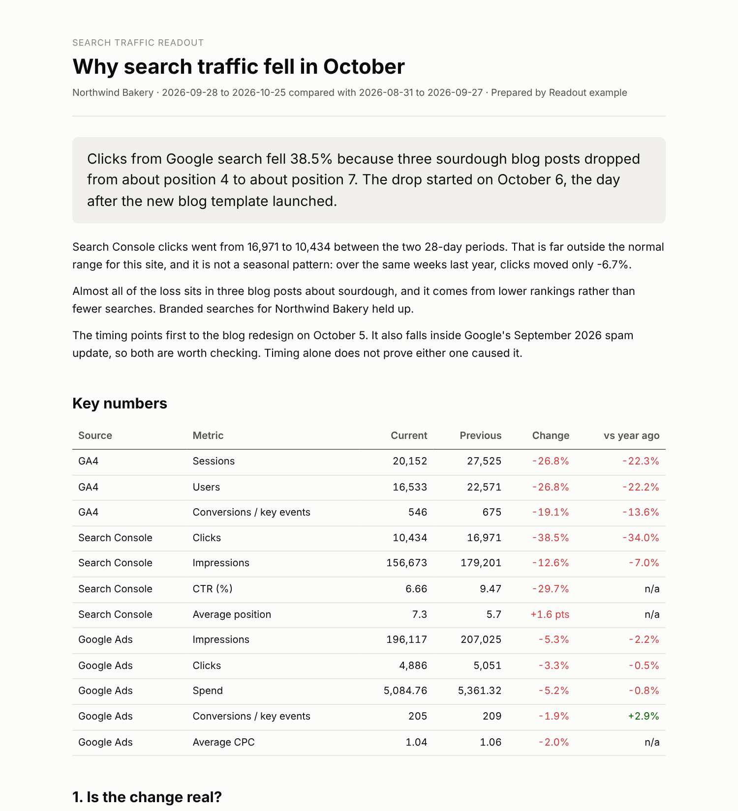

# Readout

**Claude skills that turn GA4, Search Console and Google Ads exports into answers a client can read.**

Readout is a free, open toolkit for SEO, GEO and marketing consultants. Drop in the exports you
already download, and get back clean combined data, a health check, and a plain-language
explanation of what changed and why.

It is built on one rule: **scripts calculate, Claude explains.** Every number in a Readout
summary or report comes from Python, not from the language model. The report builder refuses
to publish a narrative containing a number it can't trace back to the calculated results.

## Start here (no coding needed)

1. **Download** `readout-traffic-aggregator.zip` and `readout-change-explainer.zip` from the
   [latest release](../../releases/latest). Don't unzip them.
2. **In Claude, turn on code execution:** Settings > Capabilities > Code execution and file creation.
3. **Upload both zips** under Skills (Create skill > Upload a skill), and switch them on.
4. **Start a chat**, attach your exports, and ask: *"Why did search traffic drop last month?"*

Step-by-step help with troubleshooting: [No-code setup guide](docs/no-code-setup.md).
How to get your data out of Google's tools: [Export guide](docs/exporting-data.md).



## Skills

| Skill | What it answers | Outputs |
|---|---|---|
| [`traffic-aggregator`](skills/traffic-aggregator/SKILL.md) | "Give me one clean view of all my data." Merges GA4, Search Console and Google Ads, checks data health, summarizes channels, and shows numbers that never match side by side. | Chat summary, Excel workbook, standard CSV, charts |
| [`change-explainer`](skills/change-explainer/SKILL.md) | "Why did traffic drop?" Six questions in order: Is it real? Is it unusual? Where? What kind of change? When did it start? What should be checked next? | Chat summary, client-ready HTML report, charts |

Both skills accept exports exactly as downloaded: Search Console zips, GA4 CSVs with their
comment lines, Google Ads reports with title rows and totals. No reformatting, no API keys.

## Who it's for

Solo SEO and GEO consultants reporting to several clients, one client at a time. The data
work that usually eats an afternoon (combining exports, checking for tracking gaps, finding
which pages moved, lining the drop up with site changes and Google updates) takes a few
minutes, and the result is written for the client, not for an analyst.

## Quick start

### In Claude (web or desktop)

Follow the [No-code setup guide](docs/no-code-setup.md). To build the zips yourself instead of
downloading them from a release, run `python tools/package_skills.py`; they appear in `dist/`.

### In Claude Code

Copy the skill folders into your skills directory:

```bash
cp -r skills/traffic-aggregator ~/.claude/skills/readout-traffic-aggregator
cp -r skills/change-explainer ~/.claude/skills/readout-change-explainer
```

### From the command line, without Claude

The scripts run on their own:

```bash
pip install -r requirements.txt
python skills/traffic-aggregator/scripts/aggregate.py sample-data/northwind-bakery --out out/aggregate
python skills/change-explainer/scripts/explain.py sample-data/northwind-bakery \
  --events sample-data/northwind-bakery/events.csv --brand-terms "northwind" --out out/explain
```

You get all the numbers and charts. The written explanation is the part Claude adds.

## Try it with the sample data

`sample-data/` holds synthetic exports for two fictional clients, each with a story built in:

- `northwind-bakery/`: three blog posts lose rankings the day after a site redesign, and GA4
  tracking breaks for one day.
- `lakeview-plumbing/`: service pages gain rankings a few days after a content refresh, and a
  Google Ads campaign is paused.

The finished outputs are in [`examples/northwind-bakery/`](examples/northwind-bakery/),
including the [client report](examples/northwind-bakery/explain/report.html).

## How it works

```
exports ─► load (detect source, read messy formats) ─► standard daily table
                                                        │
          health checks ◄───────────────────────────────┤
          channel summary, side by side ◄───────────────┤  traffic-aggregator
          six-question diagnosis ◄──────────────────────┘  change-explainer
                         │
                findings.json ─► Claude writes narrative ─► number check ─► report
```

Design choices:

- **Numbers from tools that measure different things are never added together.** Search Console
  clicks, GA4 sessions and Google Ads clicks are shown side by side, with the reasons they differ.
  A sudden change in the gap is flagged as a possible tracking problem.
- **Tracking is checked before anything is diagnosed.** Near-zero days, every channel dropping
  at once, and shifts in the GA4 to Search Console ratio are caught first. On small sites,
  ordinary zero-click days are not mistaken for tracking gaps.
- **"Coincides with", never "caused by".** The trend shift is matched to your own event log and
  to a dated list of Google updates. Timing is reported as timing.
- **Seasonality is tested, not assumed.** Each change is compared with this site's normal
  28-day swings and with the same weeks last year.

## Repo structure

```
readout/
├── skills/
│   ├── traffic-aggregator/   SKILL.md, scripts/, references/
│   └── change-explainer/     SKILL.md, scripts/, references/ (Google update list), templates/
├── shared/readout_core/      source of truth for shared code (copied into each skill)
├── docs/                     exporting guide, channel grouping
├── sample-data/              synthetic exports for two fictional clients
├── examples/                 finished outputs from the sample data
├── tools/                    sync shared code, package skills, make sample data
└── tests/
```

Each skill carries its own copy of `readout_core` so it works when uploaded on its own. Edit
`shared/readout_core`, then run `python tools/sync_shared.py`. CI fails if a copy is out of date.

## Limits

- **Export formats** were built from commonly seen layouts and tested on synthetic files plus one
  real 16-month Search Console export from a small site. GA4 and Google Ads parsers have not yet
  been tested on real exports. If a file isn't recognized, Readout says which one and why.
  Issues with anonymized examples are very welcome.
- Numbers must use US formatting (1,234.56).
- Thresholds that label patterns ("unusual", "ranking loss") are rules of thumb, listed in
  `findings.json` so they can be questioned.
- The Google update list is maintained by hand. The skill warns when a trend shift is newer
  than the list.

## Roadmap

- Stakeholder translator: the same data written for executives, developers, sales and content
- AI referral segmenter: separate ChatGPT, Perplexity and similar referrals in GA4
- SEO ticket writer: audit findings to developer tickets with acceptance criteria
- More sources: Meta Ads, email platforms
- Portfolio view across clients
- Optional GA4 and Search Console connectors instead of exports

## Contributing

The most useful contributions right now:

1. **Real export samples** (anonymized) that Readout fails to read.
2. **Google update list entries** in `skills/change-explainer/references/google_updates.csv`,
   with a link to Google's Search Status Dashboard. Update `last_updated` in the `.meta.json` file.

Run `python -m pytest -q` before opening a pull request.

## License

MIT. See [LICENSE](LICENSE).

Built by BrieFreelancing.
